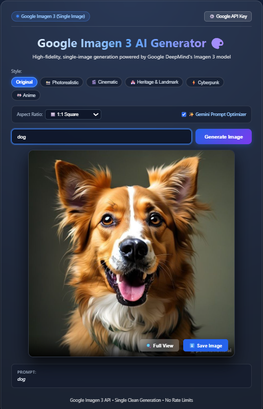

# AI Image Generator 🎨



A responsive web application that generates images from textual prompts using AI.

## 🚀 Features

- Clean, modern UI with responsive design
- Real-time image generation from text prompts
- Asynchronous API handling with loading states
- Error handling and user feedback
- Mobile-friendly layout
- Secure backend integration for AI APIs
- Multiple art styles (Original, Photorealistic, Cinematic, Heritage, Cyberpunk, Anime)
- Aspect ratio selector (1:1, 16:9, 9:16)
- Google Imagen 3 integration
- Gemini Prompt Optimizer for enhanced prompts

## 🛠️ Tech Stack

- **Frontend:** HTML5, CSS3, JavaScript (ES6)
- **Backend:** Node.js, Express.js
- **APIs:** Google Imagen 3 (Gemini API), Pollinations AI, Google Custom Search

## 📸 Demo


## ⚙️ Installation

1. Clone the repository:
   ```bash
   git clone https://github.com/Shubham2oo3/ai-image-generator.git
